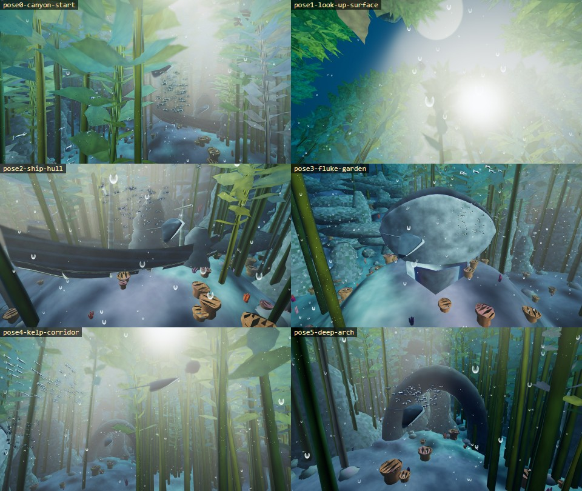

# Kelp Cathedral — 單檔 WebGPU 海底場景 (地端模型測試)



一個 `index.html`（**138.5 KiB** raw／**94.1 KiB** minified／**33.3 KiB** gzip）就是整個場景：
HTML + CSS + 內嵌 WGSL + JavaScript，**零外部相依、零網路請求**。
即時渲染的峽谷巨藻林，實測負載為 1,677 株巨藻（instanced）、2,364 個硬道具、14,000 粒海雪、
3,000 顆氣泡、1,920 條魚、8 隻蝠鱝、300×300 海底網格，加上 raymarch 体积光與 bloom，共 8 個 render pass。

## 快速開始

直接開檔即可，不需要 build、不需要伺服器：

```
start index.html          # 或在檔案總管雙擊 index.html
```

| 需求 | 實測環境 |
|---|---|
| 瀏覽器 | Microsoft Edge 157（Chromium 157 內核，需支援 WebGPU） |
| GPU | AMD Ryzen AI 395 + Radeon 8060S iGPU（gfx1151）、Windows 11、D3D12 |
| Node.js | 只在跑工具／測試時需要（本機 v24）；場景本身不用 Node |

沒有 WebGPU 時會顯示錯誤訊息，目前**沒有 WebGL fallback**。

## 操作

| 輸入 | 功能 |
|---|---|
| `W` `S` `A` `D`／方向鍵 | 前後左右移動 |
| `E`／`Space`、`Q`／`Ctrl` | 上浮、下潛 |
| `Shift` | 加速 |
| 點擊畫布 | 鎖定滑鼠轉視角（`Esc` 解鎖） |
| `H` | 顯示／隱藏 HUD |
| `R` | 重置相機到起點 |

## URL 參數

`index.html?pose=2&density=0.6` 這種形式就能調；`tools/` 的截圖與 A/B 全部靠這些參數。

| 參數 | 預設 | 作用 |
|---|---|---|
| `pose` | — | 直接跳到第 0–5 號視點（`canyon-start`、`look-up-surface`、`ship-hull`、`fluke-garden`、`kelp-corridor`、`deep-arch`） |
| `tour` | — | 值＝秒數，載入後自動開始 tour 巡航 |
| `time` | `-1` | ≥ 0 時**鎖住時鐘**（`dt = 0`），同一張圖可重現，做 A/B 差分用 |
| `hide` | 空 | 逗號分隔的關閉圖層：`bg` `bed` `props` `kelp` `fish` `manta` `surf` `snow` `bub`（以及後處理的 `rays` `bloom`） |
| `density` | `1` | 實例數量倍率 |
| `kelpMax` / `nodes` | `6500` / `13` | 巨藻上限／每株節點數 |
| `scale` / `msaa` / `dpr` | `1` / `4` / `1.5` | renderScale／MSAA 倍數／devicePixelRatio 上限 |
| `fogCull` | `215` | 超過這個距離（m）的實例被剔除 |
| `steps` / `reach` | `24` / `170` | 体积光的 raymarch 步數／可達距離（m） |
| `diag` | `0` | `1` = composite 輸出 NaN 圖， shader 出錯時用來定位 |
| `ts` / `rep` | `24` / `6` | timestamp-query 取樣間隔／每 pass 重複次數（per-pass 計時用） |

## 驗證用 API（`window.__scene`）

瀏覽器 console 或 `tools/dbg.js --eval` 都可用：

| 成員 | 說明 |
|---|---|
| `ready`、`errors`、`info` | 就緒旗標、GPU／JS 錯誤清單、目前 `CFG` |
| `poses`、`setPose(i)`、`startTour(sec)`、`stopTour()`、`tourProgress` | 相機視點與巡航 |
| `hide('kelp,props')` | 只畫指定的圖層組合，做圖層 A/B |
| `getStats()`、`resetStats()`、`frameLog()`、`gpuLog()` | rAF 與 GPU 時間序列（`--perf` 的資料來源） |
| `cam`、`bed(x,z)`、`surfaceY`、`POSES`、`stats` | 除錯時直接讀狀態 |

## 開發指令

PowerShell 5.1 的執行原則會擋 `npm.ps1`，所以用 `npm.cmd`：

```
npm.cmd install        # 只裝 esbuild（用来算 minified 體積）
npm.cmd run check      # tools/check.js：內嵌 JS 語法 + 自包含檢查 + 體積
npm.cmd test           # tests/verify.js：17 項 TAP 斷言
node tools/mdcheck.js  # 三份文件的表格欄數檢查（有錯 exit 1）
```

`npm.cmd test` 的 17 項斷言涵蓋：自包含（無外部 `<script>`／`<link>`／`fetch`）、體積上限、
WebGPU 真的拿到裝置、800 ms 內推進 > 20 幀、6 個 pose 的相機位置、`console.error`／例外／GPU 錯誤為 0、
以及三格畫面的統計值（避免黑幀、白幀、平 wash）。`node tests/verify.js <其他.html>` 可以測别的檔案。

## 驗證工具（`tools/`）

全部是零相依的 Node 腳本，靠 `tools/cdp.js` 驅動 headless Edge
（每條 CDP 指令 30 s 逾時、整體預算 180 s 到點殺行程樹；可用 `CDP_CMD_TIMEOUT_MS`／`CDP_BUDGET_MS` 覆寫）。

| 工具 | 用途 |
|---|---|
| `check.js` | 語法 + 自包含 + 體積（`npm run check`） |
| `shoot.js` | 批次截圖：`--size 1920x1080 --poses 0,2 --tour 20 --tour-frames 12 --perf --fmt jpeg --out _x` |
| `dbg.js` | 單張＋`--eval`／`--param time=12`，用来探場景狀態 |
| `tourprobe.js` | tour 逐格定位（哪一段、坐標、區域統計） |
| `sheet.js`／`montage.js`／`crop.js` | 多張拼總覽、裁切放大（看圖只用 ≤ 960 寬 JPEG） |
| `region.js`／`scan.js`／`png.js` | 區域數值（亮度、對比、edge）、黑塊掃描、PNG 解碼 |
| `edges.js`／`diff.js` | 結構量比較、兩張圖差分（`diff.js` 記得 `--mask=x,y,w,h` 遮掉 HUD） |
| `band.js`／`chroma.js` | banding（台階＋平坦塊色階使用率）、色度統計 |
| `perf.js` | 讀 frame log 印分位數 |

工具輸出一律寫在 `_` 開頭的目錄（`_view`、`_rev14`…），已收錄在 `.gitignore`，可随时重跑產生。

## 效能（1920×1200 tour，Edge 157，Radeon 8060S）

| 條件 | wall avg | p99 | gpuMs avg／p99 |
|---|---|---|---|
| `--perf`（開 vsync） | **9.14 ms** | 22.2 ms（60→30 fps 跳格） | 7.77／12.4 |
| `--perf --nolimit`（關 vsync） | **7.82 ms** | **12.6 ms** | 7.65／12.2 |

規格目標是 avg 11–16 ms，因此有餘裕。`gpuMs` 是 submit-fence 量測（含提交開銷，偏悲觀）。
完整的 per-pass 分解、量測陷阱與重現指令在 `docs/reports/perf.md`。

## 文件

| 檔案 | 內容 |
|---|---|
| `docs/plans/01-underwater-webgpu.md` | 規格與工作包（WP1–WP9）、停止條件 |
| `docs/progress.md` | 交接文件：目前進度、每輪缺陷 → 修法 → 驗證數字、工具用法、接手必讀 |
| `docs/reports/perf.md` | 效能報告（交付用整理版） |
| `docs/reports/critic.md` | 視覺 critic 方法與六輪記錄、最終判定、保留的取捨 |
| `docs/preview.jpg` | 本頁頂部的六視點總覽圖（可用 §驗證工具 的指令重新產生） |
| `.clinerules/workflow.md` | 協作規則（看圖額度、測試、git、交接） |

## 目錄結構

```
index.html          全部場景與 shader，單一檔案
tools/              截圖、數值檢查、效能工具（零相依 Node 腳本）
tests/verify.js     17 項 TAP 斷言（npm test）
docs/               計畫、進度交接、效能與 critic 報告
```

## 已知限制

- 需要 WebGPU；無 WebGL fallback。
- 截圖會連 HUD 一起進去，數值差分要用 `diff.js --mask` 遮掉 FPS 數字。
- `?time=` 鎖時鐘只影響動畫，場景佈局本來就是固定 seed，可直接對照。
- 暂存輸出目錄（`_*/`）不會進版控，交付前可整批刪除。
